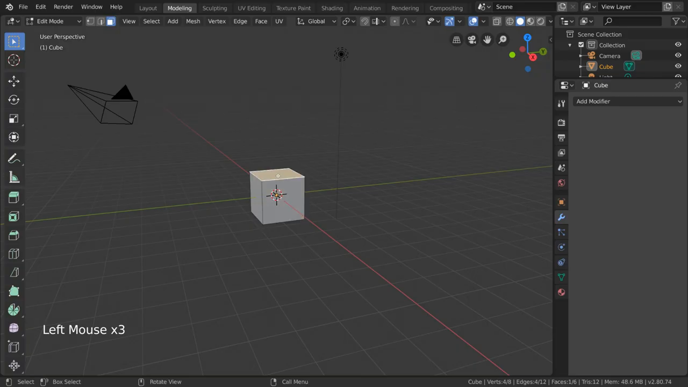
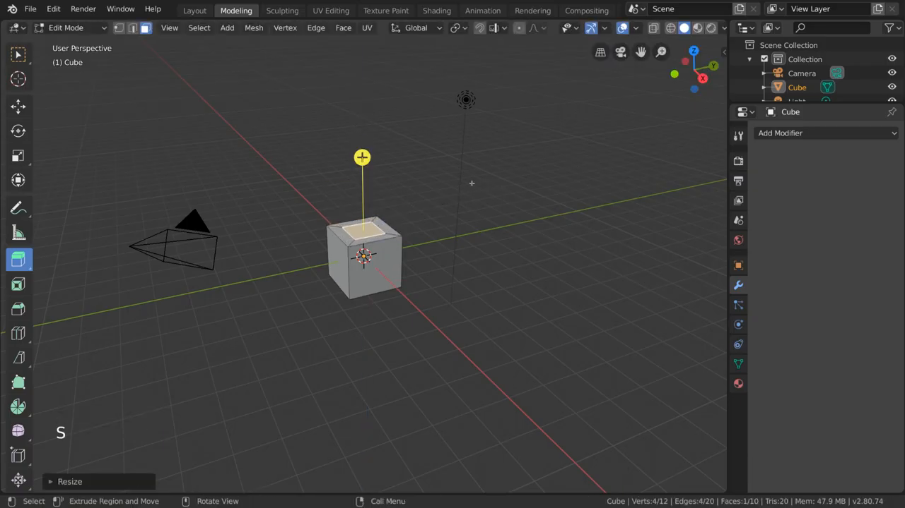
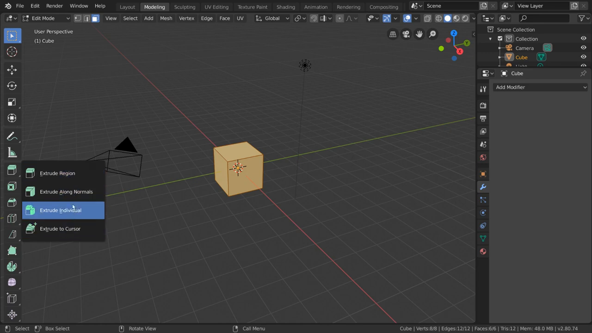
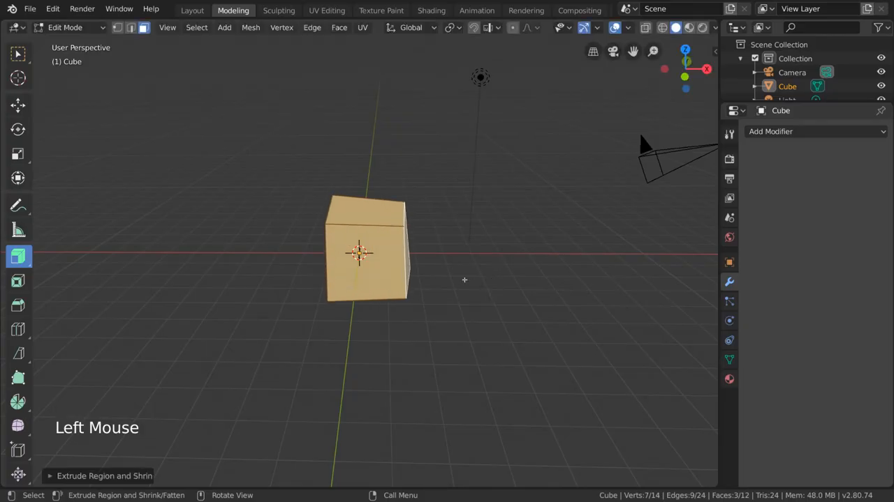
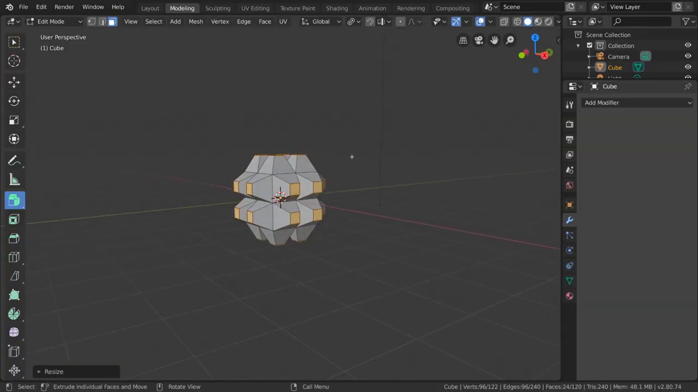
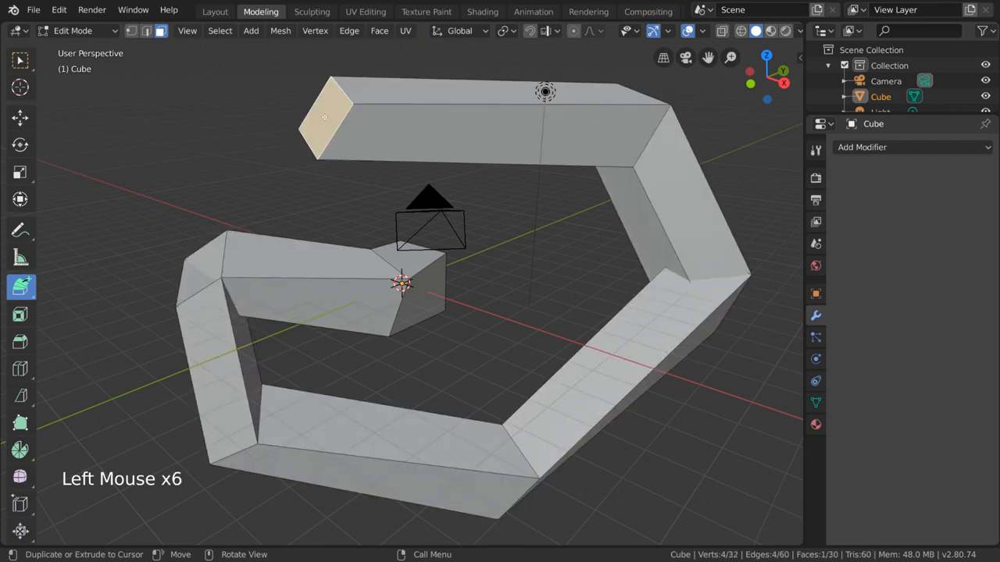
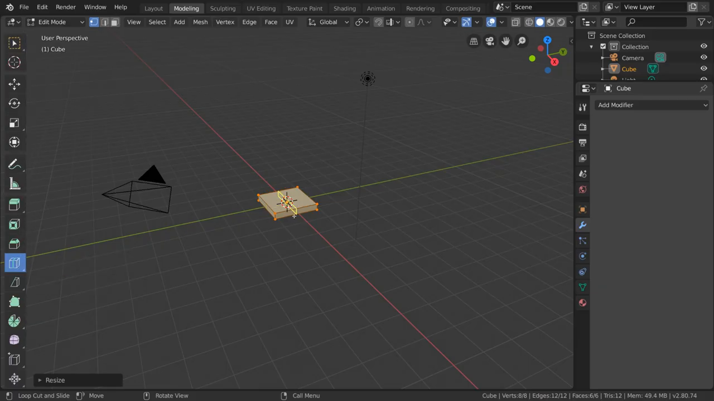
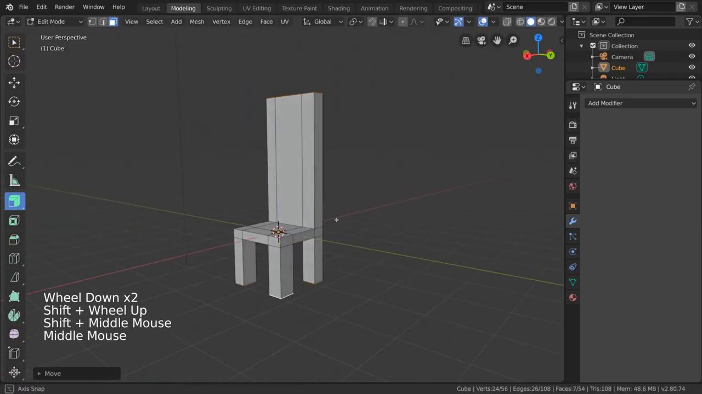

# Blender 2.80 - Extrude tool: how the commands work

Source video: *Extrude - Blender 2.80 Fundamentals* by Blender Foundation (https://www.youtube.com/watch?v=2qD_tcPMhOs), licensed CC BY 3.0. This brief and the frames are derived from it.

Tags: [S] = stated in speech; [I] = inferred from images/on-screen text, not spoken.

## Summary
The video (4:46) teaches Extrude in Blender 2.80 Edit Mode: select geometry, then extrude it with the Quick Tools (left toolbar) tool or the E key. Extrude duplicates the selection, moves it (by default along the average normal) and creates connecting edges/faces. It covers cancelling an extrude (right-click) which leaves the duplicate in place, four sub-tools (Region, Along Normals, Individual, to Cursor), and ends with a chair built from a flattened, loop-cut cube using Extrude Along Normals.

## Commands and concepts

**Edit Mode + Face select** - Mode dropdown top-left of the 3D viewport; face-select is the third icon next to it [I: 00-10]. Extrude works on faces, edges and vertices [S]. Selection counts in the status bar (e.g. `Verts:4/8 Edges:4/12 Faces:1/6`) [I].

**Extrude tool (Quick Tools / left toolbar)** - [S] Select a face, click the Extrude tool: a yellow gizmo appears. [I: 01-44] The gizmo is an arrow line ending in a yellow circle with "+", standing on the selected face. Tooltip [I]: "Extrude region together along the average normal", shortcut "Tweak Left". Status bar while active [I]: left-click = "Extrude Region and Move".
- Left-click-drag the gizmo: duplicates the face and moves it along the normal [S]; also creates new edges and faces between original and duplicate [S].
- Left-click-drag anywhere else in the viewport: moves the extrusion on the view plane [S].
- Works on multiple faces, vertices, edges [S].

**Normal** - [S] vector perpendicular to a face's surface. With several faces pointing in different directions, the gizmo points to the average of their directions [S]. (Presenter: "we'll come back to it later" - done via Extrude Along Normals.)

**Cancel extrude (right-click while dragging)** - [S] cancels the move but does NOT remove the duplicated faces. Intentional: new geometry stays at the original location, useful for scaling/rotating the extrusion. Cancelled extrusion returns to the original surface [S]. To truly remove an extrusion: Ctrl+Z [S].
- Stacked-cubes recipe [S]: extrude, right-click cancel, press S to scale down, extrude again, confirm. [I: 01-44] After S the "Resize" operator panel appears bottom-left; top face smaller, stats `Verts:4/12 Faces:1/10`.

**E key (hotkey)** - [S] begins moving the extruded selection along its normal; right-click cancels (same behaviour as above), left-click confirms.

**Extrude sub-tool menu** - [S] click-and-drag the Extrude icon in Quick Tools to open a submenu. [I: 02-32] Four entries: Extrude Region, Extrude Along Normals, Extrude Individual, Extrude to Cursor. Default tooltip [I]: "Extrude freely or along an axis", shortcut "Shift Spacebar, E".
1. **Extrude Region** - default, skipped in narration [S].
2. **Extrude Along Normals** - [S] for multiple faces pointing in different directions: pushes geometry outward along each face's own normal while faces stay connected; good for adding thickness. [I: 02-48] Whole cube selected; status bar left-click = "Extrude Region and Shrink/Fatten"; operator panel "Extrude Region and Shrin..."; result `Verts:7/14 Faces:3/12`.
3. **Extrude Individual** - [S] each face extrudes independently from neighbours; use for spikes or stylized bumps; works best with faces selected, not floating vertices or edges. [I: 03-15] Status bar: "Extrude Individual Faces and Move"; result is a many-faced bumpy cube (`Verts:96/122 Faces:24/120`).
4. **Extrude to Cursor** - [S] extrudes the selection to wherever you left-click in the viewport, on the viewing plane; rough and quick. Hotkey (Edit Mode, any time): hold Ctrl + right-click [S]. [I: 03-33] Status bar left-click = "Duplicate or Extrude to Cursor"; overlay "Left Mouse x6" - six successive clicks produced a chained, bent tube of boxes (`Faces:1/30`).

## Step by step
- [00:08] Select top face of default cube (Edit Mode, face select), click Extrude tool, yellow gizmo appears.  *(shows Edit Mode UI, face-select icon active, 1 face selected, "Left Mouse x3" overlay)*
- [00:17] Explain "normal axis manipulator" and normals. [S]
- [00:31] Drag gizmo: face duplicates, side faces created. [S]
- [00:48] Drag elsewhere in viewport: move on view plane. [S]
- [01:01] Select faces facing different ways; gizmo points to the average direction. [S]
- [01:15] Right-click cancel keeps duplicate faces in place. [S]
- [01:35] Stack of cubes: extrude, right-click, S to scale down, extrude, confirm. [S] 
- [01:59] Ctrl+Z to remove an extrusion cleanly. [S]
- [02:07] E key: extrude along normal; right-click cancel, left-click confirm. [S]
- [02:23] Drag Extrude icon to open submenu. [S] 
- [02:34] Extrude Along Normals on several faces; thickness. [S] 
- [02:57] Extrude Individual; spikes/bumps; faces preferred. [S] 
- [03:19] Extrude to Cursor; clicks place the extrusion; Ctrl+right-click shortcut. [S] 
- [03:46] Chair tutorial. [S] Select cube, Edit Mode, scale down along Z (flat slab) [S].  *(flattened cube, Loop Cut and Slide)*
- [04:03] Loop Cut tool (own video): left-click-drag to make a tic-tac-toe pattern of cuts [S]. [I] Edge Slide panel shown: -0.0172, Even OFF, Clamp ON.
- [04:22] Face select; select faces for chair back and legs [S].
- [04:30] Extrude Along Normals subtool, left-click-drag: back and legs extrude together [S]. [I] Selection `Verts:24/32 Edges:26/60`.
- [04:43] Result: chair. 

## Seen but not said
- UI: Blender 2.80.74, Modeling workspace, Edit Mode, face-select active; left toolbar with Extrude icon highlighted when active; tooltips/status-bar hints name the operators (see above). [I]
- Extrude icon submenu lists exactly four entries in this order: Region, Along Normals, Individual, to Cursor. [I]
- Gizmo look: yellow arrow with "+" circle. [I]
- After cancel + S, a "Resize" panel appears bottom-left (operator redo panel); stats show duplicated geometry still present (Verts 4/12, Faces 1/10) although the extrusion distance is zero. [I]
- Key/mouse overlay at bottom-left shows pressed inputs (e.g. "Left Mouse x6", "S", "Shift + Middle Mouse"). [I]
- Final chair frame: Face select, Move panel, status "Axis Snap", stats `Verts:24/56 Faces:7/54`. [I: 04-44]
- Loop-cut frame shows vertex-select mode active and a flattened cube (`Verts:8/8 Faces:6/6`). [I: 04-14]

## Open questions
- Exact numeric extrusion distances or scale factors are never shown or spoken.
- The 03-15 frame shows Extrude Individual after a scale (Resize panel); whether individual faces were scaled/moved by the presenter is not stated.
- Which exact faces form the chair back/legs (indices) is only visible in the frames, not described; the cut count of the loop cut is "tic-tac-toe" (2x2 cuts, inferred) and not spoken as a number.
- Shortcut shown for Extrude to Cursor in the tooltip is not read from a frame; only the spoken Ctrl+right-click is known.
